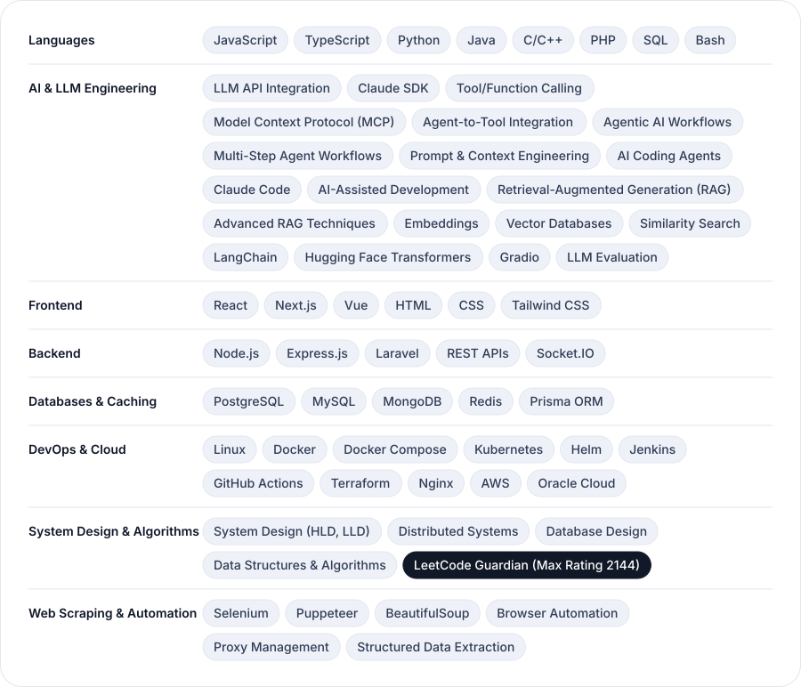

<!-- Generated by build/readme.py in the sathishr424.github.io repo. Edit content.py there, not this file. -->
<a href="https://sathishr424.github.io/"><picture><source media="(prefers-color-scheme: dark)" srcset="assets/header-dark.svg"></picture></a>

  <a href="https://sathishr424.github.io/"><picture><source media="(prefers-color-scheme: dark)" srcset="assets/btn-site-dark.svg"></picture></a>
  <a href="https://sathishr424.github.io/Sathish-Kumar-Resume.pdf"><picture><source media="(prefers-color-scheme: dark)" srcset="assets/btn-resume-dark.svg"></picture></a>
  <a href="https://linkedin.com/in/sat-this-h"><picture><source media="(prefers-color-scheme: dark)" srcset="assets/btn-linkedin-dark.svg"></picture></a>
  <a href="https://www.upwork.com/freelancers/~01b87d2baf21208fc5"><picture><source media="(prefers-color-scheme: dark)" srcset="assets/btn-upwork-dark.svg"></picture></a>
  <a href="https://leetcode.com/u/sat_this_h/"><picture><source media="(prefers-color-scheme: dark)" srcset="assets/btn-leetcode-dark.svg"></picture></a>
  <a href="mailto:rsathishikumar3@gmail.com"><picture><source media="(prefers-color-scheme: dark)" srcset="assets/btn-email-dark.svg"></picture></a>

Full Stack Software Engineer with 5 years of experience designing, building and shipping production web applications, backend services, data pipelines and real-time systems end to end. Delivered 90+ client projects as a Top Rated Upwork engineer, owning requirements, architecture, implementation and deployment. Comfortable extending large legacy codebases (Java optimization engine, Vue.js/Node.js platform at Pando) as well as building systems from scratch, including a real-time voice AI pipeline backed by 800+ automated tests. Hands-on with Docker, Kubernetes, Terraform and CI/CD, and strong in algorithms (LeetCode Guardian, max rating 2144).

I'm looking for a full-stack or backend role on a product team, working on real-time systems, data pipelines or AI-powered features. I also take freelance projects.

## Things I've built

<table>
<tr>
<td width="50%" valign="top">

<h3><a href="https://sathishr424.github.io/projects/mock-ai.html">Mock AI</a></h3>
A voice interviewer that talks back: practice interviews out loud and get a scored report with a stronger answer. 
Python · FastAPI · WebSockets · TypeScript · Whisper 
<a href="https://sathishr424.github.io/projects/mock-ai.html">Case study</a>
</td>
<td width="50%" valign="top">

<h3><a href="https://sathishr424.github.io/projects/satchat.html">SatChat</a></h3>
A real-time chat platform built to scale out, with presence, read receipts, files and GIFs, deployed on Kubernetes. 
React · TypeScript · Node.js · Socket.IO · Redis 
<a href="https://sathishr424.github.io/projects/satchat.html">Case study</a> &nbsp;<a href="https://satdevopsdummies.xyz/">Live demo</a> &nbsp;<a href="https://github.com/Sathishr424/ChatApp_plus_devops">Source</a>
</td>
</tr>
<tr>
<td width="50%" valign="top">

<h3><a href="https://sathishr424.github.io/projects/text-editor-engine.html">Text Editor Engine</a></h3>
A multi-page document editor built from scratch on HTML Canvas, with its own text model, layout, cursor and undo. 
TypeScript · HTML Canvas · Data structures · Dependency injection · Pub/sub 
<a href="https://sathishr424.github.io/projects/text-editor-engine.html">Case study</a> &nbsp;<a href="https://github.com/Sathishr424/DistributedRealTimeCollaborativeDocumentEditor">Source</a>
</td>
<td width="50%" valign="top">

<h3><a href="https://sathishr424.github.io/projects/resume-builder.html">Resume Builder</a></h3>
A resume builder with a live A4 preview, four templates, drag-to-reorder sections and PDF export, in plain TypeScript. 
TypeScript · No UI framework · Vite · Tailwind CSS · React (templates) 
<a href="https://sathishr424.github.io/projects/resume-builder.html">Case study</a>
</td>
</tr>
</table>

## Client work

Built for clients on Upwork. The NDA projects are shown with names and data removed.

<table>
<tr>
<td width="33%" valign="top">

<h3><a href="https://sathishr424.github.io/projects/ecommerce-scraping.html">E-commerce Scraping</a></h3>
Product catalogs from 51 online stores, 300k+ products in total, delivered as import-ready CSV and Excel files. 
Python · Selenium · undetected-chromedriver · BeautifulSoup · Proxies 
<a href="https://sathishr424.github.io/projects/ecommerce-scraping.html">Case study</a>
</td>
<td width="33%" valign="top">

<h3><a href="https://sathishr424.github.io/projects/price-tracker.html">E-commerce Price Tracker</a></h3>
A price-tracking site following thousands of products across 6 major US retailers, with live deals and price history. 
Vue.js · Laravel · MySQL · Bootstrap · Scraping 
<a href="https://sathishr424.github.io/projects/price-tracker.html">Case study</a>
</td>
<td width="33%" valign="top">

<h3><a href="https://sathishr424.github.io/projects/custom-order-builder.html">Custom Order Builder</a></h3>
A 2-step product builder for a custom-apparel business that prices bulk orders live, so customers skip the quote. 
Laravel · PHP · MySQL · JavaScript · Shopify checkout 
<a href="https://sathishr424.github.io/projects/custom-order-builder.html">Case study</a>
</td>
</tr>
</table>

## Competitive programming

<a href="https://leetcode.com/u/sat_this_h/"><picture><source media="(prefers-color-scheme: dark)" srcset="assets/leetcode-dark.svg"></picture></a>

My solutions are in [LeetcodeProblems](https://github.com/Sathishr424/LeetcodeProblems), and the Neovim setup I practice with is [LeetcodeCompanion](https://github.com/Sathishr424/LeetcodeCompanion).

## Skills

<picture><source media="(prefers-color-scheme: dark)" srcset="assets/skills-dark.svg"></picture>

More detail, case studies and my resume at <a href="https://sathishr424.github.io/">sathishr424.github.io</a>

